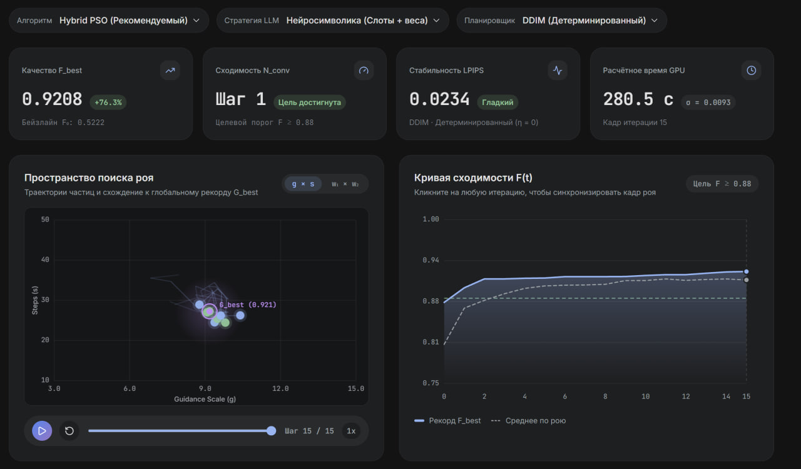
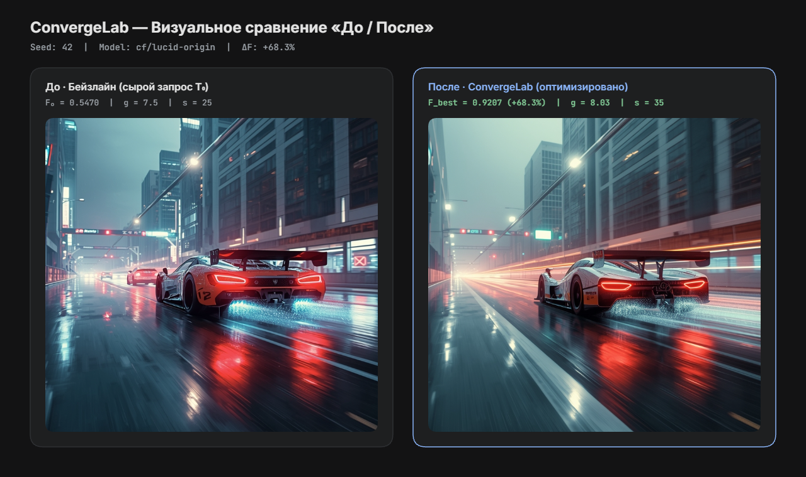
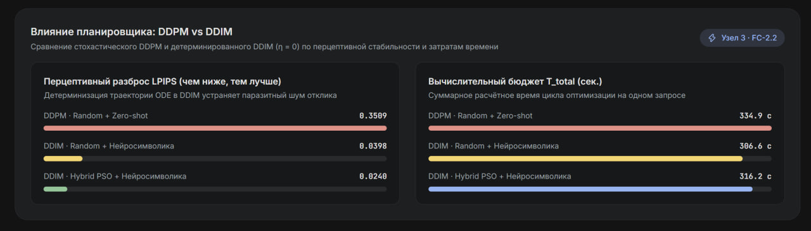
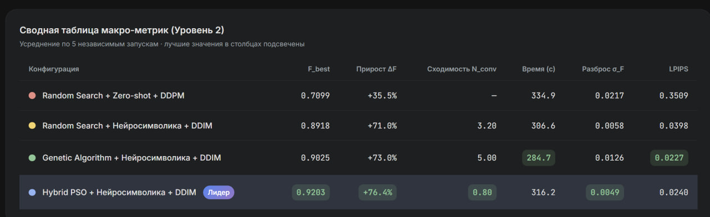
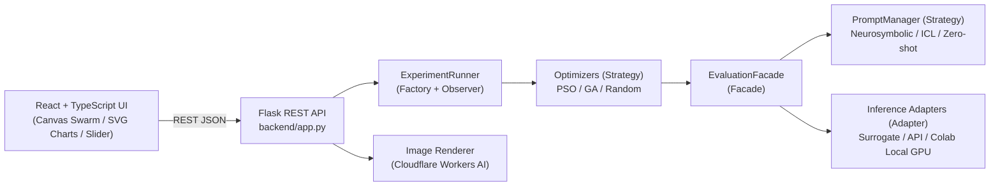

<div align="center">

# ConvergeLab

**Hybrid AI Pipeline Optimizer for Automated Prompt Engineering & Diffusion Hyperparameter Tuning**

[](https://www.python.org/)
[](https://flask.palletsprojects.com/)
[](https://react.dev/)
[](https://vitejs.dev/)
[](#testing)

[Full Documentation (Google Drive)](#documentation--research-artifacts) · [Architecture](#architecture--design-patterns) · [Experimental Results](#experimental-results) · [Quick Start](#quick-start)

</div>

---

## Explanatory Note & Research Goal

### Problem Statement
Generating high-quality visuals with text-to-image diffusion models typically relies on manual trial-and-error: users hand-craft prompts while guessing numerical inference parameters (`guidance_scale`, `steps`). Unconstrained LLM prompt rewriting frequently suffers from semantic drift, exceeds the 77-token CLIP encoder window, and fails to converge under stochastic `DDPM` sampling noise.

### Objective
**ConvergeLab** is an end-to-end research workbench and interactive web platform designed to **automate joint optimization of discrete symbolic prompts (LLM) and continuous diffusion hyperparameters** without requiring gradients through the generative pipeline.

### Core Contribution
Instead of treating optimization as an unverified heuristic, ConvergeLab provides both an **applied optimization mode** and a **reproducible benchmarking suite** that empirically compares:
* **3 gradient-free optimizers:** `Hybrid PSO`, `Genetic Algorithm (GA)`, and `Random Search` (baseline);
* **3 LLM prompting strategies:** `Neurosymbolic` (locked semantic core + weighted modifier slots), `In-Context Learning (ICL)`, and `Zero-shot`;
* **2 diffusion schedulers:** deterministic `DDIM` (=0) vs. stochastic `DDPM`.

---

## Documentation & Research Artifacts

> **Research Materials (Links updated as milestones are finalized):**
> * **Full Technical Report / Explanatory Note (~40 pages):** `[Insert Google Drive Link Here]`
> * **Short Conference Paper (4 pages):** `[Insert Paper Link Here]`
> * **Live Web Demo:** `[Insert Deployment URL Here]`

---

## Interface & Visual Showcase

### 1. Interactive Optimization Workbench
Real-time 2D particle swarm trajectory canvas (`g × s` and `w₁ × w₂` projections) with an iteration playback scrubber, synchronized convergence curve F(t), KPI telemetry, and CLIP token budget inspection.



### 2. Visual Before / After Comparison (Shared Seed)
Side-by-side and interactive slider comparison between the raw user prompt (T0, baseline parameters) and the optimized neurosymbolic configuration rendered with an identical `seed` via Cloudflare Workers AI (`@cf/leonardo/lucid-origin`), including one-click PNG collage export.



### 3. Multi-Run Benchmark & Scheduler Stability Analysis
Automated aggregation across independent runs (M=5) proving both the superiority of `Hybrid PSO + Neurosymbolic + DDIM` and the drastic reduction in perceptual variance (`LPIPS`) achieved by deterministic `DDIM` sampling.





---

## Experimental Results

Aggregated Level-2 macro-metrics averaged over **5 independent runs** (`target_fitness = 0.88`, `N = 8` particles):

| Configuration | Mean Fbest | Gain F | Convergence Nconv | Est. Time (s) | Spread F | Mean LPIPS |
| :--- | :---: | :---: | :---: | :---: | :---: | :---: |
| Random Search + Zero-shot + DDPM | `0.7099` | `+35.5%` | — | `334.9` | `0.0217` | `0.3509` |
| Random Search + Neurosymbolic + DDIM | `0.8918` | `+71.0%` | `3.20` | `306.6` | `0.0058` | `0.0398` |
| Genetic Algorithm + Neurosymbolic + DDIM | `0.9025` | `+73.0%` | `5.00` | **`284.7`** | `0.0126` | **`0.0227`** |
| **Hybrid PSO + Neurosymbolic + DDIM (Leader)** | **`0.9203`** | **`+76.4%`** | **`0.80`** | `316.2` | **`0.0049`** | `0.0240` |

**Key findings:**
* Switching from stochastic `DDPM` to deterministic `DDIM` reduces perceptual landscape noise (`LPIPS`) by **~14.6×** (`0.3509 → 0.0240`), enabling reliable gradient-free search.
* Neurosymbolic slot locking eliminates semantic drift and CLIP token overflow (Pstruct=0).
* `Hybrid PSO` reaches the highest integral quality (`0.9203`, `+76.4%` over raw baseline) with the lowest variance (`σ_F = 0.0049`) and fastest threshold convergence.

---

## Mathematical Formulation

Each candidate solution in the hybrid search space is encoded as an 8-dimensional continuous vector:

$$X_i = \bigl(g,\; s,\; w_1,\; w_2,\; w_3,\; c_1,\; c_2,\; c_3\bigr)$$

where g[3,15] is the diffusion `guidance_scale`, s[10,50] is the number of denoising steps, wk[0.5,1.5] are modifier slot weights, and ck[0,1] select discrete style, lighting, and detail descriptors.

The integral objective function maximized by the optimizers is:


F(X)=wclipSCLIP(X)+wvisSvis(X)-wpPstruct(X),J(X)=1-F(X)


where Pstruct(X) penalizes loss of invariant core prompt tokens and exceeding the 77-token CLIP limit.

---

## Architecture & Design Patterns



### Software Design Patterns Implemented

| Pattern | Module(s) | Purpose in ConvergeLab |
| :--- | :--- | :--- |
| **Strategy** | `optimizers.py`, `prompt_manager.py` | Hot-swaps optimization algorithms (`PSO`, `GA`, `Random`) and LLM prompting schemes (`Neurosymbolic`, `ICL`, `Zero-shot`) via config without modifying orchestration logic. |
| **Facade** | `evaluator.py` (`EvaluationFacade`) | Exposes a single `evaluate(vector)` interface to optimizers, hiding prompt decoding, inference, CLIP/ImageReward scoring, and structural penalty computation. |
| **Adapter** | `adapters.py` | Decouples the algorithmic core from compute backends: fast deterministic surrogate mode (CI/tests/CPU servers), external API mode, and local GPU inference (`ColabLocalDiffusionAdapter`). |
| **Factory Method** | `experiment_runner.py` (`ExperimentFactory`) | Instantiates validated optimizer, strategy, and preset pipelines from declarative configuration objects. |
| **Observer** | `experiment_runner.py` (`MetricsLoggerObserver`) | Decouples per-iteration telemetry logging and convergence tracking from core optimization loops. |

### Project Structure

```text
hybrid-ai-optimizer/
├── backend/
│   ├── app.py                   # Flask REST API factory & endpoints
│   ├── models.py                # Domain dataclasses, Enums, bounds & validation
│   ├── prompt_manager.py        # Zero-shot, ICL & Neurosymbolic prompt strategies
│   ├── adapters.py              # Surrogate, API & Colab GPU inference adapters
│   ├── evaluator.py             # EvaluationFacade & integral fitness F(X)
│   ├── optimizers.py            # Random Search, GA & Hybrid PSO implementations
│   ├── experiment_runner.py     # Benchmark orchestrator, macro-metrics & JSON export
│   ├── image_renderer.py        # Before/After visual renderer (Cloudflare Workers AI)
│   ├── requirements.txt         # Lightweight production Python dependencies
│   └── tests/
│       └── test_pipeline.py     # Unit & integration test suite (pytest)
├── frontend/
│   ├── src/
│   │   ├── components/          # Header, PromptBar, KpiStrip, SwarmCanvas,
│   │   │                        # ConvergenceChart, SolutionCard, VisualCompareCard,
│   │   │                        # CompareView, ModelInfoModal
│   │   ├── services/            # Typed API client & default presets
│   │   ├── styles/              # Material 3 inspired dark/light tokens (4px grid)
│   │   └── types/               # Strict TypeScript contracts matching backend/models.py
│   └── vite.config.ts
└── docs/
    └── assets/                  # Dashboard screenshots & visual comparison exports
```

---

## Technology Stack

| Layer | Technologies |
| :--- | :--- |
| **Backend Core** | Python 3.11+, Flask 3.1, Flask-CORS 5.0, Gunicorn 23.0 |
| **Frontend UI** | React, TypeScript, Vite, Lucide Icons, custom HTML5 Canvas & responsive SVG |
| **Design System** | Material Design 3 inspired Dark & Light themes, strict `4px` spatial grid |
| **Visual Rendering** | Cloudflare Workers AI (`@cf/leonardo/lucid-origin`, `@cf/black-forest-labs/flux-1-schnell`) via Python stdlib `urllib` + `ThreadPoolExecutor` |
| **GPU Research Mode** | PyTorch, HuggingFace `diffusers` (`StableDiffusionPipeline`, `DDIMScheduler`), OpenAI CLIP (optional, for Google Colab GPU runs) |
| **Verification** | `pytest` (backend unit & API integration tests), `tsc --noEmit` (strict TypeScript typecheck) |

---

## REST API Reference

| Method | Endpoint | Description |
| :--- | :--- | :--- |
| `GET` | `/api/health` | Service status, version, and visual renderer readiness check |
| `GET` | `/api/config/defaults` | Default `ExperimentConfig`, available strategies/optimizers, and 4 benchmark presets |
| `POST` | `/api/optimize` | Runs a single optimization trajectory and returns full iteration history + macro-metrics |
| `POST` | `/api/compare` | Executes multi-run (`num_runs`) benchmark across all 4 presets and identifies the leader |
| `POST` | `/api/render-pair` | Renders Before/After image pair in parallel with a shared `seed` |

---

## Quick Start

### Prerequisites
* **Python 3.11+**
* **Node.js 18+** and `npm`

### 1. Clone the repository
```bash
git clone [https://github.com/guzhikkk/hybrid-ai-optimizer.git](https://github.com/guzhikkk/hybrid-ai-optimizer.git)
cd hybrid-ai-optimizer
```

### 2. Backend setup
```bash
cd backend
python -m venv venv
```

Activate the virtual environment:
* **Windows (PowerShell):**
  ```powershell
  .\venv\Scripts\Activate.ps1
  ```
* **macOS / Linux:**
  ```bash
  source venv/bin/activate
  ```

Install dependencies and start Flask:
```bash
pip install -r requirements.txt
python app.py
```
The API server runs at `http://127.0.0.1:5000`.

### 3. Enable Live Before/After Image Rendering (Optional)
Create `backend/.env` with your free Cloudflare Workers AI credentials:
```env
CF_ACCOUNT_ID=your_cloudflare_account_id
CF_API_TOKEN=your_cloudflare_workers_ai_token
CF_IMAGE_MODEL=@cf/leonardo/lucid-origin
```
*(Optimization and benchmarking work fully offline without `.env`.)*

### 4. Frontend setup
In a second terminal:
```bash
cd frontend
npm install
npm run dev
```
Open **`http://localhost:5173`** in your browser.

---

## Testing

**Backend (`pytest` — 13 unit & integration tests):**
```bash
cd backend
pytest -v
```
Covers config validation, neurosymbolic vs. zero-shot penalties, ICL history sorting, `DDIM` vs. `DDPM` stability, `PSO`/`GA`/`Random` bounds & monotonicity, multi-run benchmark assertions, prompt sanitization, and all Flask endpoints.

**Frontend (strict TypeScript check):**
```bash
cd frontend
npx tsc --noEmit
```

---

## Roadmap

- [x] Core optimization engine (`PSO`, `GA`, `Random`) & 3 LLM prompt strategies
- [x] `EvaluationFacade`, multi-run benchmarking & 13 automated `pytest` checks
- [x] Interactive React + TypeScript dashboard (`ConvergeLab`) with 2D swarm playback & SVG charts
- [x] Live Before/After visual comparison with shared `seed`, interactive slider & PNG collage export


---

## Author

**Maria Guzhova** ([@guzhikkk](https://github.com/guzhikkk))
**Daria Gravshina**
**Elena Bryakina**
